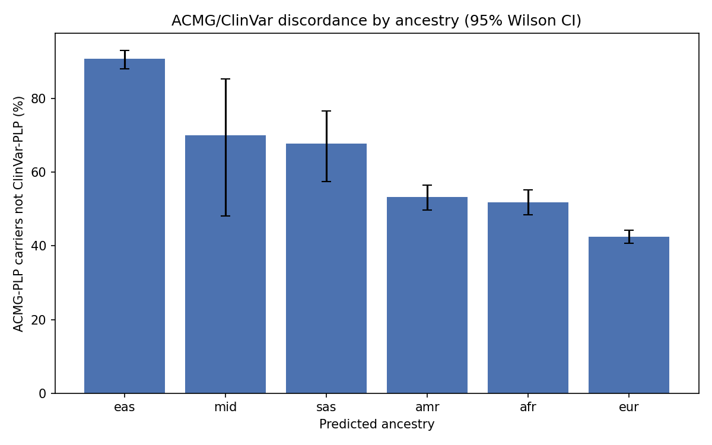
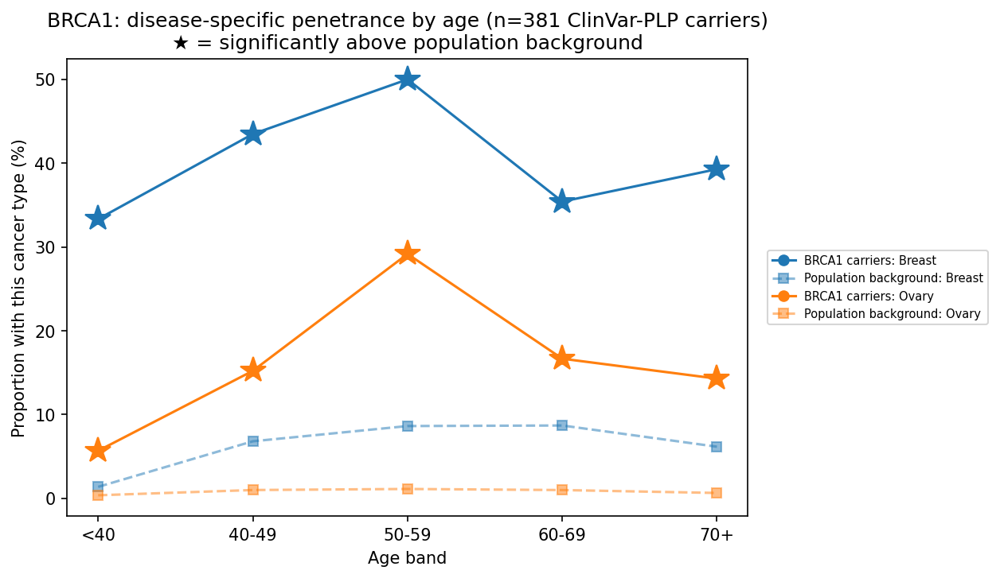
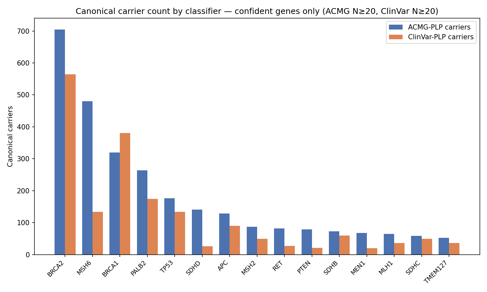

# Cancer-Gene Carrier Penetrance & Variant-Classification Concordance

Two questions asked of the same cancer-gene carrier cohort:

1. **Penetrance** — among carriers of a likely-pathogenic variant in a cancer-predisposition
   gene, what fraction develop the gene's matched cancer, and at what age?
2. **Concordance** — does ClinVar confirm ACMG-flagged pathogenic variants equally across
   ancestries, or does relying on ClinVar under-ascertain carriers in some populations more
   than others?

This repo contains the analysis code, methodology documentation, and final aggregate
results/reports. **No participant-level data is included** — see [Input data schema](#input-data-schema-required-to-run)
below for what the script expects, and bring your own data.

Developed against the All of Us (AoU) Researcher Workbench; the results in `results/` were
computed there. All numbers in `results/` are gene-level or ancestry-level aggregates — no
`person_id` or other row-level identifiers are present in any committed file.

---

## Method

**Canonical carrier denominator.** Every number in this pipeline is built from ONE fixed carrier
list per gene, constructed the same way every time:
1. Start from every raw variant row for the gene.
2. Collapse to one entry per person per gene (a person counts as ACMG/ClinVar-PLP for the gene
   if *any* of their variants in it is).
3. Restrict to **ACMG-PLP** carriers only.
4. Join to the cohort table to get age/sex/phenotype — carriers with no matching cohort record
   are dropped, and that drop is counted and reported, never silent.
5. Restrict to the correct sex if the gene's cancer type(s) are sex-specific.

This matters: an earlier, non-canonicalized version of this analysis produced three different
carrier counts for the same gene in three different tables, because each table quietly built
its own denominator. Canonicalizing means one number, reused everywhere.

**Why ACMG-PLP, not ClinVar-PLP.** ACMG is a rule-based classifier applied uniformly regardless
of ancestry. ClinVar depends on manual submissions historically concentrated in
European-ancestry variants. Defining "carrier" by ClinVar confirmation would import that same
ancestry bias directly into the penetrance denominator — which is exactly what the concordance
finding measures. A companion pipeline run (`report_acmg_vs_clinvar.html`) reruns the identical
method under ClinVar-PLP to show what that choice would cost.

**Penetrance and background rate:**

```
penetrance(gene, cancer, age band)   = N(canonical carriers with matched cancer) / N(all canonical carriers in that age band)
background rate(disease, age band)   = N(whole cohort with that disease)         / N(whole cohort in that age band)
```

Each mapped cancer type is its own line — e.g. BRCA1:Breast and BRCA1:Ovary are never merged.
A carrier only counts as "affected" if their recorded disease matches the gene's own
gene→cancer-type mapping; a BRCA1 carrier with lung cancer is not a BRCA1 event.
Family-history-only records (no personal diagnosis) are excluded from the numerator by an
assertion in the code. Both proportions get a 95% **Wilson score confidence interval**
(`statsmodels.stats.proportion.proportion_confint(method="wilson")`), preferred over the normal
approximation because many cells have small N or proportions near 0/1. A cell is marked
"significantly elevated" only when the carrier rate's CI lower bound exceeds the background
rate's CI upper bound — a conservative non-overlapping-interval test, not a formal
two-proportion hypothesis test (no p-value is computed).

**Pseudogene-artifact exclusion.** Genes with a known pseudogene/paralog mismapping problem
(e.g. PMS2/PMS2CL) can show ancestry-skewed carrier counts for purely technical reasons. PMS2 is
always excluded from main results; other watch-list genes are excluded if one non-EUR ancestry
shows more than 2× the EUR carrier count with no plausible biological explanation.

**Minimum-evidence bar.** A gene needs ≥20 canonical carriers, no artifact flag, and a defined
cancer mapping to appear in the main results ("interpretable"). Genes below the bar are listed
separately with the specific reason, never silently dropped.

Full worked examples and formulas: `results/process_walkthrough.html` and
`results/transcripts/analysis_walkthrough_bilingual.md`.

---

## Results

Full interactive reports with all genes: `results/report.html` and
`results/report_acmg_vs_clinvar.html`. Three of the more convincing figures below.

### Finding 1 — ClinVar under-confirms ACMG-pathogenic variants, unevenly by ancestry



Among carriers of an ACMG-PLP (pathogenic/likely-pathogenic) variant, the fraction with **no**
matching ClinVar-PLP confirmation for the same variant: EUR 42.5%, AFR 51.9%, AMR 53.2%, SAS
67.8%, EAS 90.9%. Every non-European ancestry's confidence interval sits clearly above EUR's —
this is not sampling noise. Practically: a pipeline that gates on ClinVar confirmation will
under-ascertain real carriers far more heavily in non-European populations than in European ones.
One caveat worth stating rather than hiding: the EAS figure is 83.5% attributable to a single
recurrent MSH6 variant (chr2:47806842) — that specific 90.9% should be read as "this one variant's
ClinVar status," not as evidence of broad-based EAS under-curation. The other ancestries' gaps are
spread across many different variants, which is the more typical under-curation signature.

### Finding 2 — Penetrance recovers known BRCA1 biology



320 canonical ACMG-PLP BRCA1 carriers (female-restricted): 44.7% develop breast or ovarian cancer,
rising through the 40s and 50s, and sitting above the population background rate (★) at every age
band measured. This is the expected shape for a well-established cancer-predisposition gene, which
is exactly why it's useful as a validation case: if the pipeline recovered BRCA1's known risk
pattern from noise, it wouldn't be trustworthy on the other 22 less-studied genes it's also
applied to. The 44.7% figure runs lower than clinic-ascertained BRCA1 penetrance estimates you may
have seen elsewhere (which select for high-risk families already flagged for testing) — expected
for an unselected, healthcare-utilizing volunteer cohort, not a red flag.

### Finding 3 — What the ClinVar confirmation gap costs in actual carriers



Rerunning the identical pipeline with ClinVar-PLP instead of ACMG-PLP as the carrier definition:
the total carrier pool across genes drops from 3,790 to 2,066 — a **45.5% loss** — concentrated
unevenly. TSC2 retains only 2.3% of its ACMG-PLP carriers (306→7); SMAD4 retains 2.2% (134→3). This
turns Finding 1's ancestry-discordance percentages into a concrete, gene-by-gene carrier-count
cost, and is the direct justification for using ACMG-PLP — not ClinVar-PLP — as the carrier
definition throughout this analysis: the alternative would have discarded nearly half the usable
carrier pool, disproportionately in exactly the genes and ancestries Finding 1 already flags.

---

## Input data schema required to run

The script expects two tables (edit `CARRIERS_PATH` / `COHORT_PATH` at the top of
`gene_penetrance.py` to point at your own files):

**Carrier-level table** (one row per person × variant):
| Column | Type | Description |
|---|---|---|
| `person_id` | str/int | Unique person identifier |
| `Gene` | str | Gene symbol |
| `Variant_ID` | str | Variant identifier (e.g. `chr:pos:ref>alt`) |
| `is_ACMG_PLP` | bool | ACMG Pathogenic/Likely-Pathogenic flag |
| `is_ClinVar_PLP` | bool | ClinVar Pathogenic/Likely-Pathogenic flag |
| `ancestry_pred` | str | Predicted ancestry group |
| `sex_at_birth` | str | `"Male"` / `"Female"` |
| `age` | float | Current age |

**Cohort table** (one row per person × recorded condition — a person may have multiple rows):
| Column | Type | Description |
|---|---|---|
| `person_id` | str/int | Unique person identifier, joinable to the carrier table |
| `age` | float | Current age |
| `sex_at_birth` | str | `"Male"` / `"Female"` |
| `Group` | str | Disease/cohort-arm label (a specific cancer type, or a Control/Family-history label) |

If your EHR + cohort tables can be mapped to this schema, the pipeline runs unchanged.

---

## How to run

```bash
pip install -r requirements.txt
python gene_penetrance.py --min_carriers 3
```

**Current limitation:** `CARRIERS_PATH` and `COHORT_PATH` are hardcoded constants at the top of
the script, not CLI arguments. The `Group`-label collapsing (`CONTROL_GROUPS`, `FAMHX_GROUPS`)
and the `GENE_CANCER_GROUPS` gene→cancer-type mapping are also hardcoded and AoU-specific.
Pointing this at a different cohort today means editing those directly — see
[Roadmap](#roadmap--extending-to-a-second-cohort) below.

---

## Outputs

Running the script regenerates everything under `results/`:
- `report.html` — main results (self-contained, embedded figures)
- `process_walkthrough.html` — methodology reference
- `report_acmg_vs_clinvar.html` — ACMG-PLP vs ClinVar-PLP carrier-definition comparison
- `results/tables/` — gene-level penetrance, disease-specific-by-age, concordance-by-ancestry,
  carrier filter logs, exclusions, ancestry breakdowns (all aggregate, no row-level data)
- `results/figures/` — per-gene disease-specific charts, concordance bar chart, ACMG-vs-ClinVar
  comparison charts
- `results/transcripts/` — plain-language walkthroughs of the method and findings 

---

## Limitations

- Crude, cross-sectional proportions — not survival/cumulative-incidence estimates; no
  adjustment for follow-up time or competing risks.
- Source cohort (AoU) is a healthcare-utilizing volunteer cohort, not a random population
  sample — subject to ascertainment bias.
- Roughly 30% of ACMG-PLP carriers per gene have no matching cohort/phenotype record and are
  dropped before any calculation (reported explicitly in the carrier filter log, not hidden).
- The pseudogene-artifact rule is a heuristic (PMS2 always flagged, a 2×-EUR-ratio check for a
  small watch-list), not an exhaustive QC pass.
- Single-cohort, preliminary, not yet validated against an independent dataset.

---

## Roadmap — extending to a second cohort

To run this against a second cohort (e.g. an external EHR-derived carrier table plus a
Group-labeled cohort table) as a genuinely plug-and-play tool, rather than a script tied to one
dataset:

1. **Parameterize the data paths.** Turn `CARRIERS_PATH` / `COHORT_PATH` into CLI arguments
   (`--carriers-path`, `--cohort-path`) instead of hardcoded module-level constants.
2. **Make cohort-specific labels configurable.** `CONTROL_GROUPS`, `FAMHX_GROUPS`, and
   `GENE_CANCER_GROUPS` currently hardcode AoU's exact `Group` string values (e.g.
   `"Control (age ≥ 50)"`). Move these to a config file (YAML/JSON) per cohort.
3. **Decide the cross-cohort analysis model.** Two options, not yet chosen: (a) pool canonical
   carriers across both cohorts before computing penetrance (more power, but only valid if the
   cohorts are comparably ascertained), or (b) run each cohort through the pipeline separately
   and report/compare the two sets of results side by side (safer default, mirrors what
   `report_acmg_vs_clinvar.html` already does for a different axis of comparison).

None of this is implemented yet — this section exists so the next iteration starts from a
concrete task list instead of re-deriving it.
